<p align="center">
  
</p>

<p align="center">
  
  
  
  
  
  
</p>

<p align="center"><b>Unit 3 Final Project · Data Exploration & Dashboard Development</b><br>
Tuwaiq Academy · Data Science & AI Bootcamp</p>

---

## 🦜 The story

I own a **green-cheeked conure** 💚. Caring for him made me wonder: *where do pet parrots come from, and what does the trade do to wild birds?*

This project joins **two real datasets** to answer that question:

| | Dataset | Source | Size |
|---|---|---|---|
| 🧾 | **CITES Trade Database**: every live parrot legally traded between countries, 1975–2024 | [trade.cites.org](https://trade.cites.org) · UNEP-WCMC | 219,115 records |
| 🪶 | **AVONET**: body measurements, diet, habitat and range of every bird species | Tobias *et al.* (2022), *Ecology Letters* | 404 parrot species |

> **Main question:** Which parrots end up in the global trade, and how has that trade changed in 50 years?

---

## 📊 Key findings

<table>
<tr>
<td align="center"><h3>22.5M</h3>live parrots traded<br>1975–2024</td>
<td align="center"><h3>51% → 5%</h3>wild-caught share<br>1990s → 2020s</td>
<td align="center"><h3>59%</h3>of all birds come from<br>just 10 species</td>
<td align="center"><h3>65%</h3>of Saudi imports arrived<br>after 2016</td>
</tr>
</table>

- 📉 **Import bans worked.** The wild-caught share dropped sharply after the **US Wild Bird Conservation Act (1992)** and the **EU ban on wild-bird imports (2005)**.
- 🌍 **Demand moved east.** **South Africa** is the world's largest exporter (5.6M birds, mostly captive-bred). Since 2015 the top buyers are Bangladesh, Iraq, Pakistan, Lebanon and the UAE.
- 🇸🇦 **Saudi Arabia** imported **277,679** parrots. Imports almost stopped from 2005 to 2014, then surged, led by lovebirds.
- ⚖️ **Size doesn't decide a parrot's fate** (Spearman ρ = 0.14). **Range size** does (ρ = 0.47): common, widespread species become pet-shop staples.
- ⚠️ **11 island species** (mostly lories and cockatoos from Indonesia and Melanesia) have a range smaller than 50,000 km² yet thousands of birds taken from the wild.

---

## 🧹 Data cleaning highlights

| Step | Problem | Fix | Rows |
|---|---|---|---|
| 1 | Duplicate rows | `drop_duplicates()` | 3 |
| 2 | Units in kg / g / shipments | keep *number of specimens* only | 40 |
| 3 | Re-exports count the same bird twice | drop rows with an `Origin` | 57,226 |
| 4 | Two partial quantity columns | exporter's figure, else the importer's | — |
| 5 | Subspecies, `spp.` and hybrids | first two words = species; `spp.` → NaN | — |
| 6 | **Different taxonomies in CITES vs AVONET** | 25-name dictionary | match **88.7% → 99.99%** |

**219,115 → 161,846 clean records.** Merged with `how="left"` so all 404 species stay, including the 98 that were never traded.

---

## 🎛️ The dashboard (Arabic, RTL)

An interactive **Arabic** Streamlit dashboard, with real photos (Wikimedia Commons) and a hand-drawn illustration of each featured species in its real colours.

| Tab | What it shows |
|---|---|
| 🌍 التجارة العالمية | World map, an animated map over 50 years (▶️), top countries, yearly trade by source with the 1992 and 2005 bans marked, Sankey of the biggest trade routes |
| 🦜 تعرّف على ببغاء | Pick any species and see a real photo or illustration, size rank, wild share, range map, trade history and care notes for pet species |
| ⚖️ قارني بين ببغاوين | Put two species side by side: photos, a stats table, trade over time and their real size |
| 🎯 أي ببغاء يناسبك؟ | A 6-question quiz (space, noise, talking, time, years, experience) that suggests the 3 best pet parrots |
| 🖼️ ألبوم الببغاوات | An album of 20 well-known species, as real photos or illustrations |
| 🪶 صفات الببغاوات | Does size, diet or habitat predict trade? Scatter, bars, box plot, heatmap |
| ⚠️ منطقة الخطر | Set your own thresholds and see the species at risk |
| 🇸🇦 السعودية والخليج | GCC imports, what they buy and where it comes from |
| 📋 البيانات | Data preview, summary statistics and CSV download |

**Sidebar filters:** year slider, body-mass slider, and clickable pills for source, family and diet.

<p align="center">
  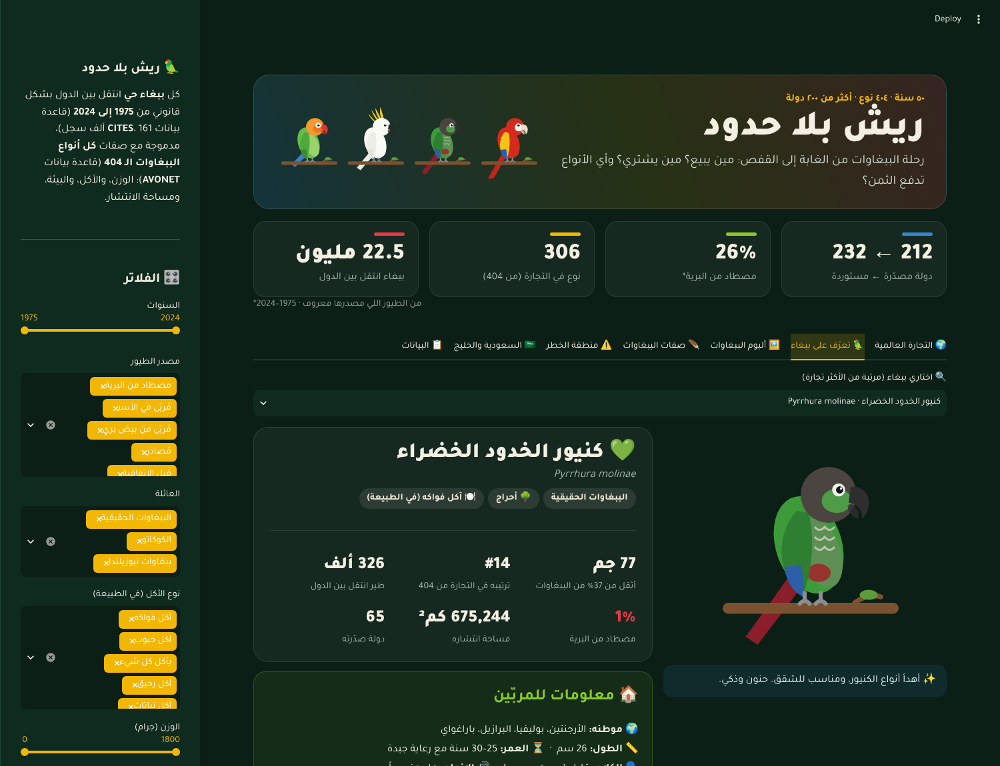
  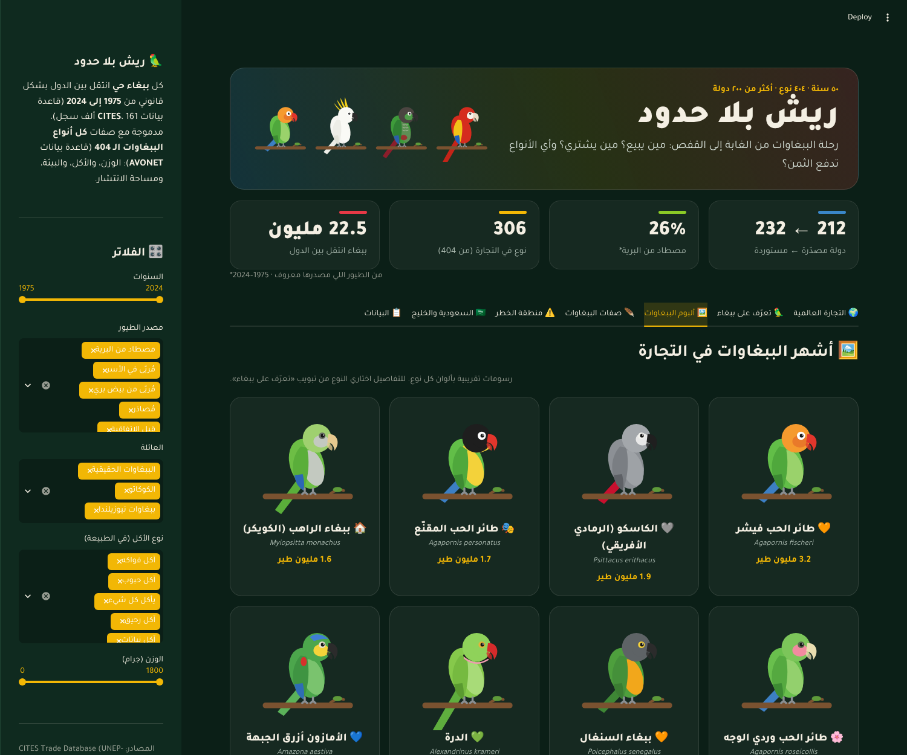
</p>
<p align="center">
  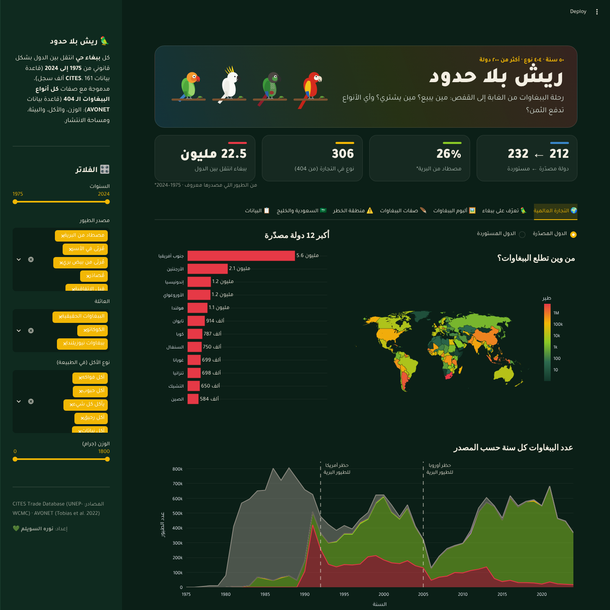
  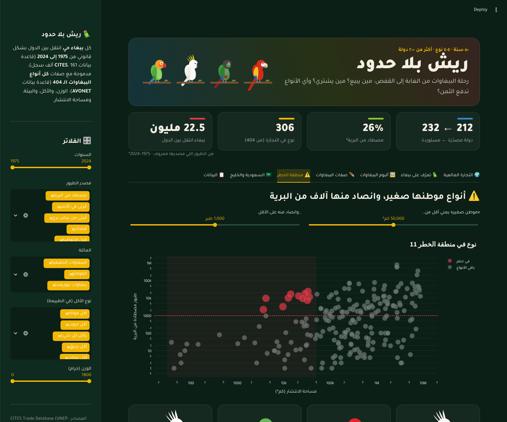
</p>

<details>
<summary>More screenshots</summary>
<p align="center">
  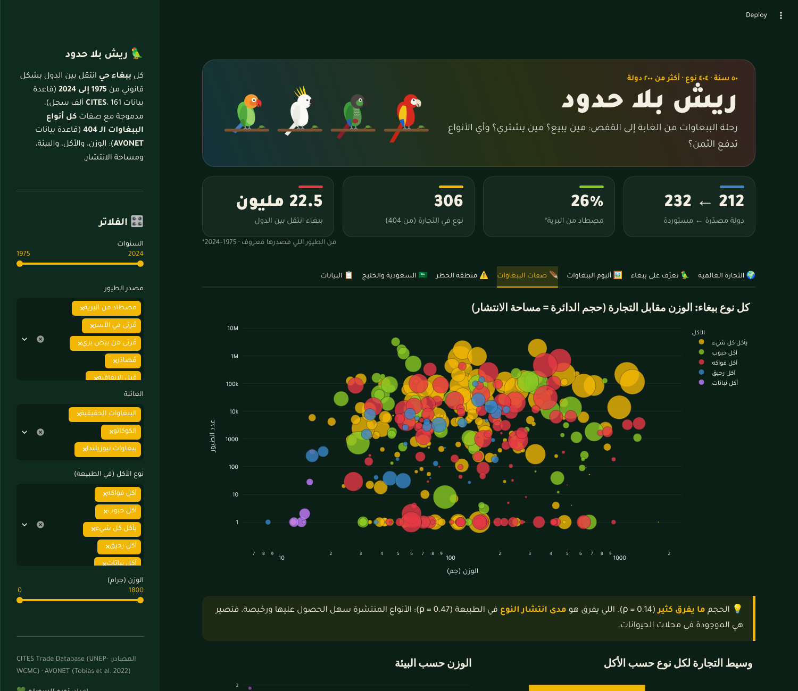
  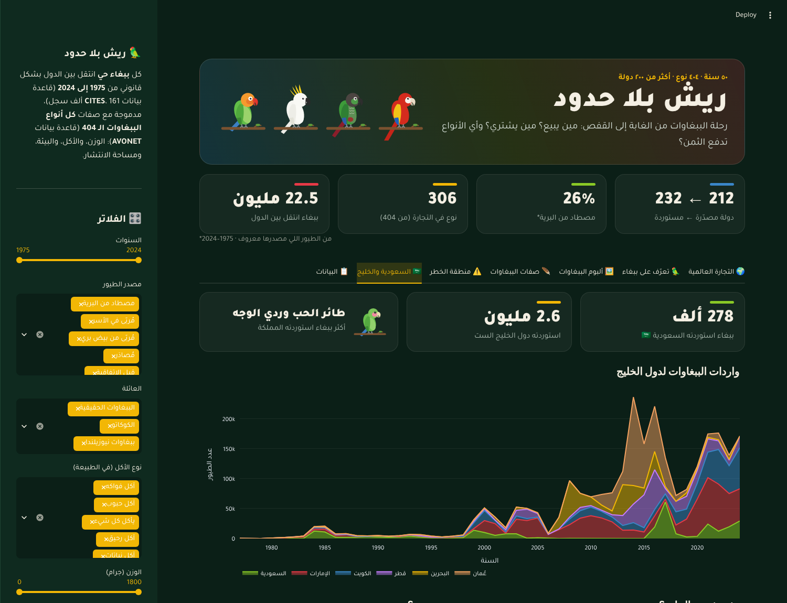
</p>
</details>

---

## 📈 EDA gallery

<p align="center">
  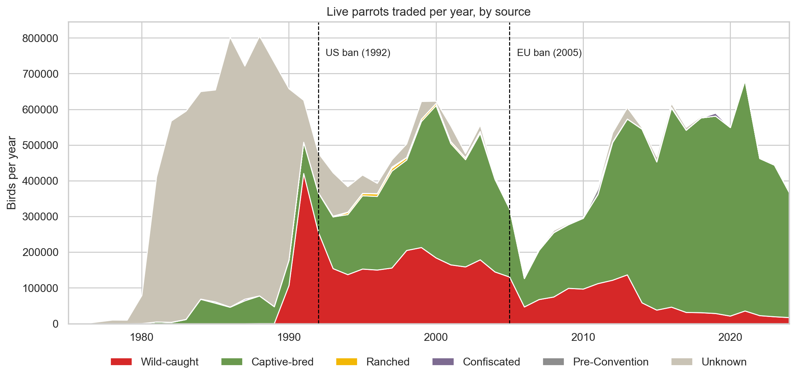
</p>
<p align="center">
  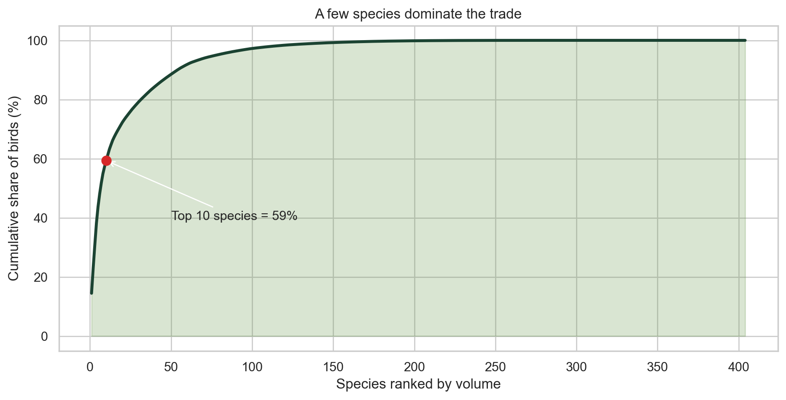
  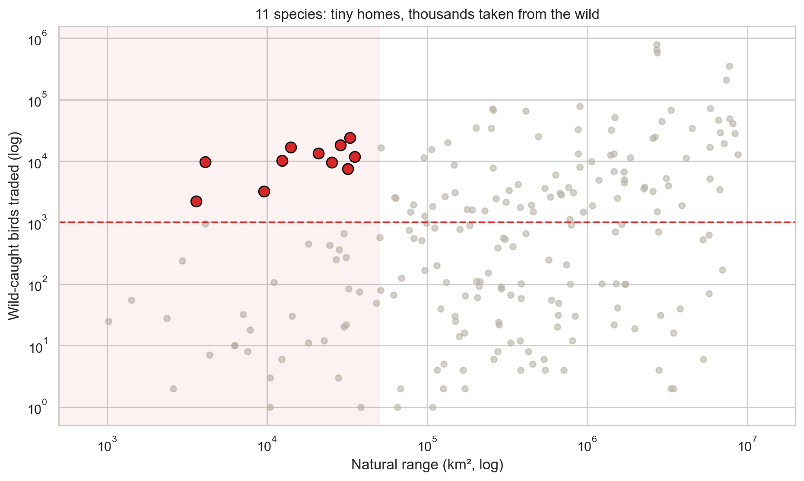
</p>
<p align="center">
  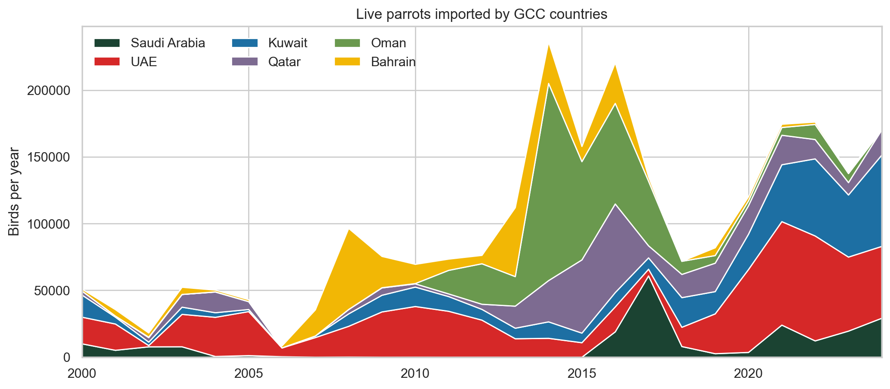
  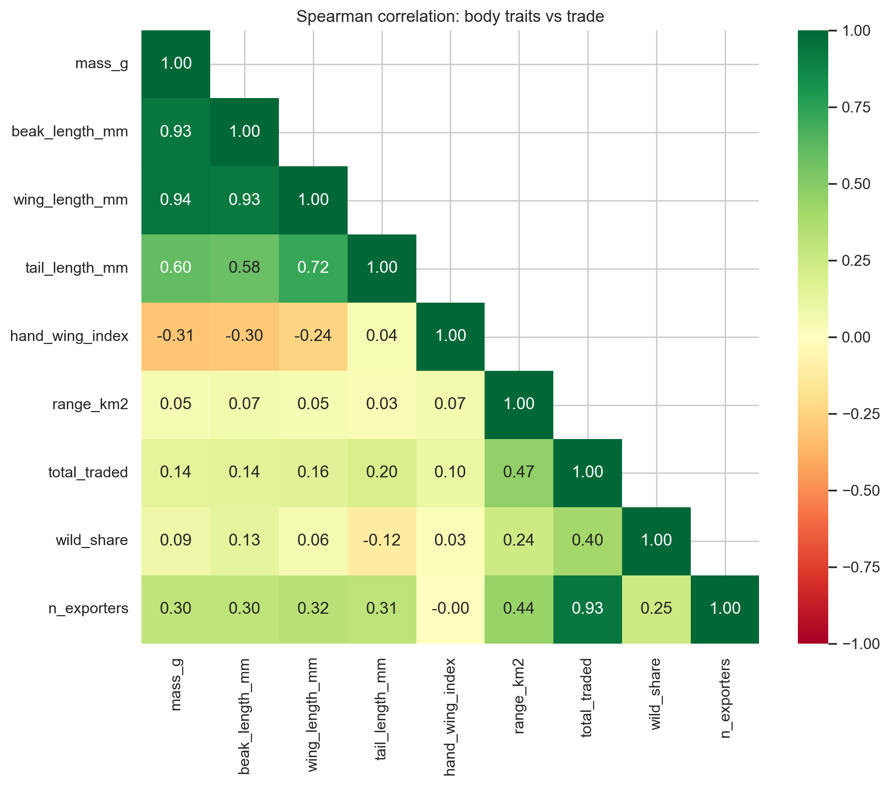
</p>

All 11 figures are in [`reports/figures`](reports/figures).

---

## 📁 Project structure

```
parrot-trade-eda/
├── data/raw/                     # original downloads
│   ├── cites_parrots.csv         #   CITES, live Psittaciformes 1975–2024
│   ├── AVONET Supplementary dataset 1.xlsx
│   └── AVONET1_BirdLife.csv      #   parrot traits (BirdLife taxonomy)
├── notebooks/
│   └── parrot_eda.ipynb          # loading → cleaning → merge → EDA → insights
├── reports/
│   └── figures/                  # 11 EDA figures
├── streamlit_app/
│   ├── app.py                    # the Arabic dashboard
│   ├── parrot_art.py             # SVG parrot illustrations
│   ├── content_ar.py             # Arabic labels, country names, species info
│   ├── data/
│   │   ├── trade_clean.csv       # 161,846 clean trade records
│   │   └── parrots_clean.csv     # 404 species × 21 columns
│   ├── .streamlit/config.toml    # theme
│   └── requirements.txt
├── assets/                       # banner + dashboard screenshots
└── requirements.txt
```

---

## ▶️ How to run

```bash
# 1. clone
git clone https://github.com/norahalsuwailem/parrot-trade-eda.git
cd parrot-trade-eda

# 2. install
pip install -r requirements.txt

# 3. run the dashboard
cd streamlit_app
streamlit run app.py
```

To re-run the analysis, open `notebooks/parrot_eda.ipynb` and choose **Run All**. It recreates the clean CSVs and all figures.

---

## ⚠️ Limitations

- CITES records **legal, reported** trade only. Illegal trafficking is not included, and 2024 is incomplete.
- Exporter and importer figures often disagree, so totals are best estimates.
- Four common pet parrots (budgerigar, cockatiel, rosy-faced lovebird, rose-ringed parakeet) were removed from the CITES lists, so their later trade is not recorded.
- AVONET diet categories describe feeding **in the wild**, which can differ from captivity.

---

## 📚 References

- CITES Secretariat & UNEP-WCMC. *CITES Trade Database*. https://trade.cites.org
- Tobias, J. A. *et al.* (2022). AVONET: morphological, ecological and geographical data for all birds. *Ecology Letters*, 25, 581–597.
- Chan, D. T. C., Poon, E. S. K., Wong, A. T. C., & Sin, S. Y. W. (2021). Global trade in parrots – influential factors of trade and implications for conservation. *Global Ecology and Conservation*, 30, e01784.
- Parrot photos: [Wikimedia Commons](https://commons.wikimedia.org) (photographer and licence shown under each photo)
- Care notes in the dashboard: [askavet.com](https://askavet.com/blogs/news/parrot-lifespan-2025-vet-guide-by-dr-duncan-houston-bvsc), [Wikipedia](https://en.wikipedia.org/wiki/Green-cheeked_parakeet), [happybirds.hu](https://happybirds.hu/en/parrot-feeding-and-care#pyrrhura)

---

<p align="center">
Made with 💚 by <b>Norah Alsuwailem</b> ·
<a href="https://github.com/norahalsuwailem">GitHub</a> ·
<a href="https://www.linkedin.com/in/norahalsuwaiilem">LinkedIn</a>
</p>
